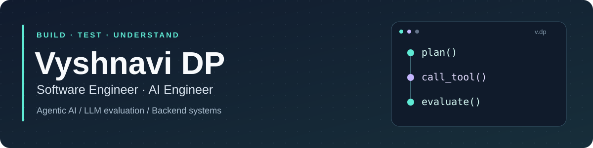

  

  <a href="https://vyshnavi.dev"><b>Portfolio</b></a> &nbsp;·&nbsp;
  <a href="https://www.linkedin.com/in/vyshnavi-dp/"><b>LinkedIn</b></a> &nbsp;·&nbsp;
  <a href="https://substack.com/@vyshudp"><b>Writing</b></a> &nbsp;·&nbsp;
  <a href="https://leetcode.com/u/vyshnavi_d_p/"><b>LeetCode</b></a> &nbsp;·&nbsp;
  <a href="mailto:vyshnavi.dyvandinnepullareddy@gmail.com"><b>Say hello</b></a>

## Hi, I'm Vyshnavi 👋

I build **backend systems and AI agents**, focusing on reliable tool use, retrieval quality, failure recovery, tenant isolation, and evaluation.

My background spans **6 years of production engineering at Accenture (client: Dell Technologies) and TCS**, followed by an **M.S. in Software Engineering at San José State University** and research in agentic AI. Here, I explore those ideas through projects with readable architecture, runnable examples, and documented tradeoffs.

**Open to Software Engineer and AI Engineer roles · Bay Area or remote**

## Start with these projects

<table>
<tr>
<td width="50%" valign="top">
<h3>🔎 <a href="https://github.com/Vyshnavi-d-p-3/Sentinel">Sentinel</a></h3>

<b>AI code review with an evaluation harness.</b>

Combines lexical and vector retrieval with structured LLM reviews, delivery deduplication, and per-PR cost limits. A scoring harness uses <b>98 synthetic fixtures</b> to report precision, recall, and F1 by issue category.

Python · FastAPI · PostgreSQL / pgvector · Next.js

<a href="https://github.com/Vyshnavi-d-p-3/Sentinel#architecture">Architecture</a> · <a href="https://github.com/Vyshnavi-d-p-3/Sentinel#evaluation-methodology">Evaluation &amp; methodology</a>

</td>
<td width="50%" valign="top">
<h3>🧭 <a href="https://github.com/Vyshnavi-d-p-3/Archon">Archon</a></h3>

<b>LLM agents with inspectable execution.</b>

A planner–executor–reflector loop with typed tool calls, retry/replan decisions, tracing, and budget middleware. Includes deterministic test backends and an evaluation harness with run manifests and statistical comparisons.

Python · Async orchestration · Tool calling · LLM evaluation

<a href="https://github.com/Vyshnavi-d-p-3/Archon#architecture">Architecture</a> · <a href="https://github.com/Vyshnavi-d-p-3/Archon/blob/main/docs/RESEARCH.md">Research &amp; reproducibility</a>

</td>
</tr>
<tr>
<td width="50%" valign="top">
<h3>🗄️ <a href="https://github.com/Vyshnavi-d-p-3/Helios">Helios</a></h3>

<b>A time-series database built in Go.</b>

Explores durable ingestion and the storage/query path through a WAL, memtables, SSTables, Gorilla compression, and label indexes. Includes a PromQL subset, streaming anomaly detection, and optional three-node Raft replication.

Go · Storage engines · Prometheus APIs · Raft

<a href="https://github.com/Vyshnavi-d-p-3/Helios#architecture">Architecture</a> · <a href="https://github.com/Vyshnavi-d-p-3/Helios#performance">Benchmarks &amp; reproduction</a>

</td>
<td width="50%" valign="top">
<h3>🏢 <a href="https://github.com/Vyshnavi-d-p-3/Kairos">Kairos</a></h3>

<b>Multi-tenant SaaS with database-enforced boundaries.</b>

An OKR tracker exploring PostgreSQL Row-Level Security, safe tenant context in pooled connections, idempotent writes, and Redis rate limiting. The README explains the isolation model and the project's current limitations.

Java · Spring Boot · PostgreSQL · Redis · TypeScript

<a href="https://github.com/Vyshnavi-d-p-3/Kairos#how-tenant-isolation-works">Tenant isolation</a> · <a href="https://github.com/Vyshnavi-d-p-3/Kairos#status-and-limitations">Design tradeoffs</a>

</td>
</tr>
</table>

**Also exploring:** [NeuroLens](https://github.com/Vyshnavi-d-p-3/NeuroLens) — adversarial robustness, from-scratch PyTorch models, and experiments in cross-modal perturbation transfer. [AdaptiveRateGuard](https://github.com/Vyshnavi-d-p-3/AdaptiveRateGuard) — Redis/gRPC rate limiting with a predictive traffic sidecar.

## How I approach engineering

- **Make failures visible.** Typed errors, execution traces, and explicit retry policies make a system easier to debug.
- **Measure changes.** Evaluation datasets, deterministic test backends, and repeatable benchmarks help distinguish improvements from assumptions.
- **Put guarantees in the right layer.** Tenant isolation belongs in database policies; durability belongs in the storage path; cost control belongs in the execution loop.

## Experience behind the projects

| Where | Role | Engineering focus |
|:--|:--|:--|
| **Accenture** Client: Dell Technologies 2021–2024 | Senior Software Engineer | SupportAssist backend services in C#/.NET, Angular/React interfaces, WebSocket updates, and a RAG-based in-app assistant |
| **TCS** 2018–2021 | Software Engineer | Java/Spring Boot services, Redis, and multi-tenant OAuth2 SSO for a retail optimization platform |
| **San José State University** 2025–2026 | Research Assistant | Agentic AI, LLM tool use, and evaluation |

## Tools I work with

| Area | Technologies |
|:--|:--|
| **Languages** | Python · Java · C# · Go · TypeScript · C++ |
| **Backend & AI** | .NET · Spring Boot · FastAPI · gRPC · LangChain · PyTorch |
| **Data & systems** | PostgreSQL · pgvector · Redis · Docker · Kubernetes · AWS · Terraform |
| **Frontend** | React · Angular · Next.js |

## Outside the main projects

I keep a [daily problem-solving log](https://github.com/Vyshnavi-d-p-3/LeetCode), mostly in C++, with accepted solutions synced from LeetCode. I also write on [Substack](https://substack.com/@vyshudp).

If you're working on **AI agents, evaluation, or backend infrastructure**, I'd be happy to connect: [portfolio](https://vyshnavi.dev) · [LinkedIn](https://www.linkedin.com/in/vyshnavi-dp/) · [email](mailto:vyshnavi.dyvandinnepullareddy@gmail.com).
